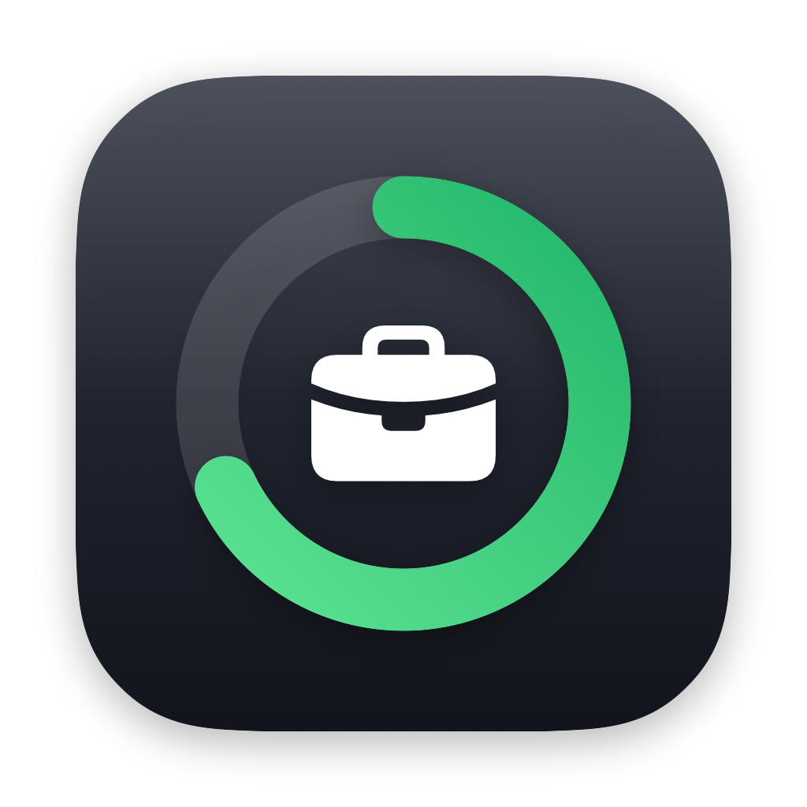
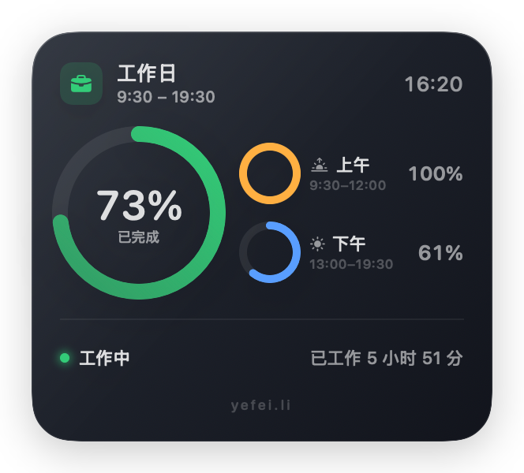
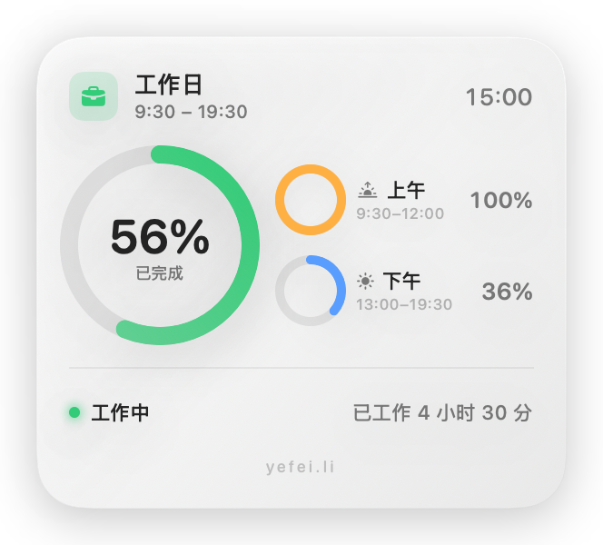
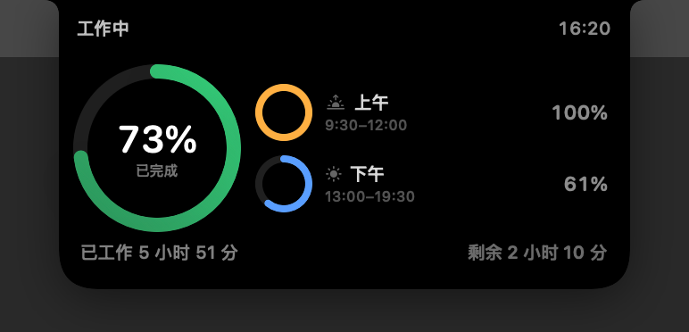
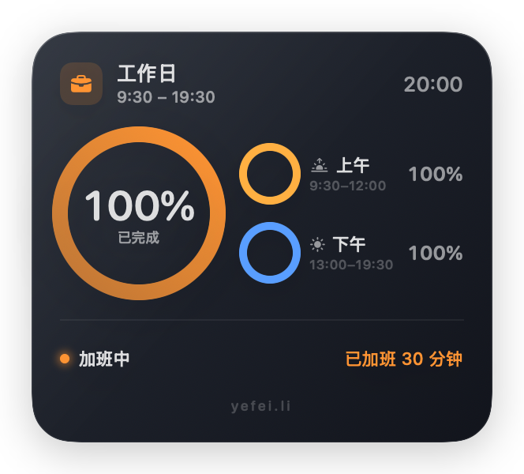
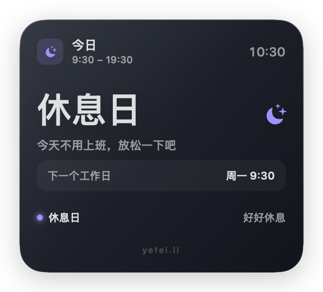

# 工作日 WorkdayWidget

一个原生 macOS 桌面小组件，用「已完成进度」展示当天的工作进度。

作者：**yefei.li** · © 2026 yefei.li



- 桌面层级的小组件（贴桌面，不被普通窗口遮挡）
- 屏幕顶部的「灵动岛」：平时完全隐藏在 MacBook 刘海里，鼠标移到刘海上时从屏幕顶边向下展开详情
- 三个圆形进度环：整体 / 上午 / 下午
- 超过下班时间显示**已加班时长**，凌晨 0 点自动重置
- 可自定义上下班、午休、晚餐休息时间，配置自动持久化

| 桌面组件（深色） | 桌面组件（浅色） |
| --- | --- |
|  |  |

| 灵动岛展开 | 灵动岛收起 |
| --- | --- |
|  |  |

| 加班状态 | 休息日 |
| --- | --- |
|  |  |

## 安装

直接用打包好的磁盘映像：

```bash
./package.sh            # 生成 dist/工作日-<版本>.dmg
./package.sh --zip      # 同时生成 zip
open dist               # 打开产物目录
```

双击 dmg，把 `WorkdayWidget.app` 拖到 `Applications`，然后从启动台运行即可。
映像里附带了「安装说明.txt」。

> 应用使用 ad-hoc 签名、未经 Apple 公证。首次打开若被 Gatekeeper 拦截，
> 在「系统设置 → 隐私与安全性」点「仍要打开」，或执行：
> `xattr -dr com.apple.quarantine /Applications/WorkdayWidget.app`

## 从源码构建

```bash
cd workday-widget
./build.sh
open WorkdayWidget.app
```

构建脚本会自动寻找可用的 Xcode 工具链。如果机器上只装了 Command Line
Tools，且其 SDK 与 Swift 编译器版本不匹配，构建会失败——请安装完整
Xcode，或设置 `DEVELOPER_DIR` 指向一个可用的 Xcode。

应用图标由 `Sources/AppIconView.swift` 渲染，首次构建时自动生成
`Resources/AppIcon.icns`。要重新生成图标：

```bash
./build.sh --icon
```

## 默认时间设置

| 项目 | 时间 |
| --- | --- |
| 上班 | 09:30 |
| 上午工作 | 09:30 – 12:00（2 小时 30 分） |
| 午休 | 12:00 – 13:00 |
| 下午工作 | 13:00 – 19:30（5 小时 30 分，含晚餐休息） |
| 晚餐休息 | 18:00 – 19:00 |
| 下班 | 19:30 |

总工作时间为 **8 小时**。上表中的「下午」包含 13:00–18:00 和
19:00–19:30 两段；晚餐休息不计入工作时间。

所有百分比都是**已完成工作占比**：

```
整体完成度 = 已工作分钟 / 全天工作分钟
上午完成度 = 上午已工作分钟 / 上午工作分钟
下午完成度 = 下午已工作分钟 / 下午工作分钟
```

例如 15:00 时：已工作 270 分钟，整体完成 56%，上午 100%，下午 36%。

## 加班与跨零点

- 19:30 之后进入「加班中」，底部显示 `已加班 X 小时 X 分`，
  整体进度环变为橙色。
- 加班时长按当天 `当前时间 - 下班时间` 计算。
- 过了凌晨 0 点，日期切换到新的一天，进度和加班时长自动重置为 0。

## 交互

### 桌面组件

- 无边框玻璃卡片，位于桌面图标层之上、普通窗口之下。
- 拖动卡片任意位置即可移动；位置自动保存。
- 右键菜单：设置、隐藏组件、退出。

### 灵动岛

- **位置**：窗口顶边与屏幕物理顶边（`screen.frame.maxY`）对齐，不是菜单栏下方。
- **收起态**：岛形尺寸等于 MacBook 刘海（本机 185 × 32pt），并按刘海实际中心对齐，
  因此被硬件刘海完全遮盖，看不出有东西在那里。进度仍可从菜单栏图标查看。
- **展开**：鼠标移到刘海上时，同一个黑色形状从屏幕顶边向下生长到 320 × 162pt，
  详情在形状内部被揭开；刘海所在的中间区域保持留空（硬件遮挡），
  状态文案和时间放在刘海左右两侧。
- 移开鼠标后形状收回刘海内，详情被完全裁掉。
- 点击可固定展开，再次点击取消固定。
- 窗口尺寸固定为 386 × 186pt，**展开 / 收起期间不 resize 窗口**，
  动画只由 SwiftUI 的形状 frame、圆角与裁切驱动，所以不会卡顿。
- 悬停检测基于鼠标坐标（`NSEvent.mouseLocation`）而不是 `onHover`：
  刘海下方的窗口收不到常规的 mouse-entered/exited 事件。
- 没有刘海的显示器（外接屏）没有可以藏身的位置，改为在屏幕顶边显示一个
  190 × 菜单栏高度的小胶囊，常驻显示迷你进度环和百分比。
- 右键菜单：固定/取消固定、设置、隐藏、退出。

### 菜单栏

菜单栏图标显示一个迷你进度环和整体完成百分比：

- 显示/隐藏桌面组件
- 显示/隐藏灵动岛
- 工作时间统计…（⌘T）
- 设置…（⌘,）
- 退出工作日

## 工时记录与统计

App 会记录每天**实际工作了多久**，并把结果写在本地文件里：

```
~/Library/Application Support/Workday/worklog.json
```

菜单栏 → **工作时间统计…** 可以按本周 / 本月 / 全部查看汇总和每日明细。

### 下班时间怎么来的

取当天**最后一次锁屏**的时间作为下班时间。macOS 不提供锁屏历史 API，所以
App 通过 `com.apple.screenIsLocked` 分布式通知在**运行期间**实时记录；它是个
常驻菜单栏 agent，正常情况下一直都在。

- 没观测到锁屏的日子，按排班下班时间结算，明细里来源会标成「排班」而不是「锁屏」，
  统计里也单独提示有多少天来自锁屏，不会把排班值伪装成实际值。
- 凌晨 0:00–06:00 的锁屏算作**前一天**的下班，跨零点加班也能记对。
- 实际工时 = 上班时间 → 下班时间之间的时长，扣掉午休和晚餐休息，下班后继续待着的部分算加班。

### 什么时候结算

第二天**上班时间**到了才结算前一天的数据（这也是拿到前一天完整锁屏记录的最早时机）。
App 启动、从睡眠唤醒、以及每分钟的时钟 tick 都会触发一次补算，所以当天没开电脑也不会漏。

### 需要知道的两点

- **App 必须在运行**。关掉 App 期间发生的锁屏观测不到，那天会回退到排班时间。
  设置里可以打开「登录时自动启动」（默认关闭，不会擅自改你的登录项）。
- 「最后一次锁屏」不区分「下班」和「单纯离开电脑」。如果晚上 23:00 还在用电脑
  然后锁屏，那天就会被记成 23:00 下班。

## 设置

菜单栏图标 → **设置…**，可修改：

- 上班 / 下班时间
- 是否启用午休，以及午休起止时间
- 是否启用晚餐休息，以及起止时间
- 是否显示桌面组件 / 灵动岛
- 登录时自动启动（工时记录需要 App 常驻）

时间类设置通过 `UserDefaults` 持久化，修改后立即生效。

## 开发

```bash
# 构建并在 preview/ 下生成预览图
./build.sh --preview

# 查看某个时间点的计算结果
./WorkdayWidget.app/Contents/MacOS/WorkdayWidget --dump --at 15:30

# 渲染指定时间 / 状态 / 浅色模式的预览图
./WorkdayWidget.app/Contents/MacOS/WorkdayWidget --render out.png --at 10:45
./WorkdayWidget.app/Contents/MacOS/WorkdayWidget --render out.png --at 20:00
./WorkdayWidget.app/Contents/MacOS/WorkdayWidget --render out.png --at 10:00 --light
./WorkdayWidget.app/Contents/MacOS/WorkdayWidget --render out.png --at 10:45 --island
./WorkdayWidget.app/Contents/MacOS/WorkdayWidget --render out.png --at 10:45 --island --compact
./WorkdayWidget.app/Contents/MacOS/WorkdayWidget --render out.png --weekend
```

工时记录相关：

```bash
# 校验结算规则（实际工时、跨零点归属、锁屏/排班回退、幂等），失败返回非 0
./WorkdayWidget.app/Contents/MacOS/WorkdayWidget --log-selftest

# 打印已记录的工时
./WorkdayWidget.app/Contents/MacOS/WorkdayWidget --log-dump

# 渲染统计界面预览图
./WorkdayWidget.app/Contents/MacOS/WorkdayWidget --render-stats preview/stats.png
```

调试参数：

```bash
# 启动时直接打开设置窗口
./WorkdayWidget.app/Contents/MacOS/WorkdayWidget --show-settings

# 启动时直接打开统计窗口
./WorkdayWidget.app/Contents/MacOS/WorkdayWidget --show-stats

# 启动时固定展开灵动岛
./WorkdayWidget.app/Contents/MacOS/WorkdayWidget --expand-island
```

### 项目结构

```
workday-widget/
├── Sources/
│   ├── main.swift            # 入口、CLI 预览 / 校验 / 图标渲染
│   ├── AppDelegate.swift     # 窗口、菜单栏、刘海定位、悬停跟踪
│   ├── Model.swift           # 时间设置、排班计算、快照
│   ├── DesignSystem.swift    # 颜色、圆形进度环、玻璃背景
│   ├── WidgetView.swift      # 桌面组件 UI（含作者水印）
│   ├── IslandView.swift      # 灵动岛形状、刘海度量、展开状态
│   ├── SettingsView.swift    # 设置面板（含「关于」作者信息）
│   ├── AppIconView.swift     # 应用图标 artwork
│   ├── WorkLog.swift         # 工时记录：锁屏监听、结算、JSON 存储
│   ├── StatsView.swift       # 工作时间统计界面
│   ├── LaunchAtLogin.swift   # 登录项注册
│   ├── AppInfo.swift         # 作者 / 版本 / 版权元信息
│   └── Notifications.swift   # 内部通知
├── Resources/
│   ├── Info.plist            # 含 NSHumanReadableCopyright
│   └── AppIcon.icns          # 构建时生成
├── build.sh                  # 编译 + 生成图标
├── package.sh                # 打包 dmg / zip
├── dist/                     # 打包产物
└── preview/                  # 生成的预览图
```

## 作者标识

- 应用图标：`Sources/AppIconView.swift` 渲染，构建时生成 `AppIcon.icns`。
- 桌面组件底部水印：`yefei.li`（低对比度，不干扰读数）。
- 设置面板「关于」：应用图标、版本号、作者 `yefei.li`、版权行。
- 菜单栏菜单底部：`工作日 1.0.0 · 作者 yefei.li`（不可点击）。
- `Info.plist`：`NSHumanReadableCopyright = © 2026 yefei.li`。

## 说明

- macOS 没有公开的「灵动岛」系统 API。这里的灵动岛是一个无边框、
  非激活的浮动面板。实现参考了开源项目 boringNotch 的架构：固定尺寸窗口 +
  单一黑色形状（NotchShape 风格）+ 内容裁切 + 顶部锚定的展开动画。收起时
  详情内容完全被形状裁掉，展开时形状向下生长、内容在形状内部被揭开。
- boringNotch 使用 GPL-3.0 许可；本项目只参考其架构思路，形状、布局和动画
  代码均为自行实现，未复制其源码。
- 应用以 `LSUIElement` 运行，不占用 Dock 图标，只通过菜单栏和桌面组件交互。
- 小组件本身不读取工作日历 / 法定节假日；默认周一至周五为工作日。
